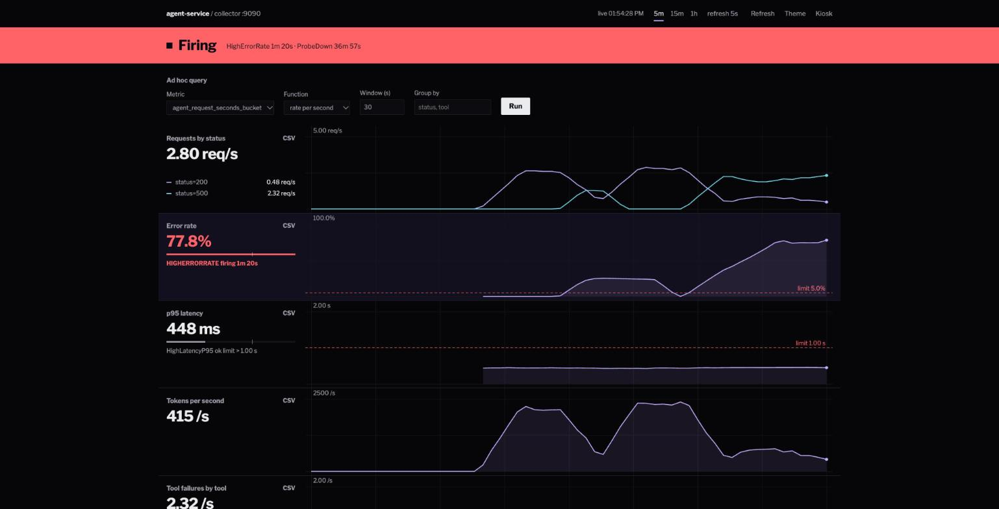

# monitoring-alerting-stack

[](https://github.com/ma67-ex/monitoring-alerting-stack/actions/workflows/test.yml)




*The dashboard during a deliberate failure: `HighErrorRate` is firing and the error-rate row is past its 5% limit.*

A small monitoring system written from scratch in Python, with no third-party packages. It has three parts: a demo service that exposes metrics, a collector that scrapes and stores them and fires alerts, and a web dashboard.

The demo service stands in for an LLM agent. It answers requests by calling one to three fake tools, and it can be told to fail or slow down on demand. That makes it easy to practice spotting and handling incidents.

```
 demo agent (:8000)  --/metrics-->  collector (:9090)  --queries-->  dashboard (:3000)
  fake tools, chaos                  scrape, store, alert            charts, alert status
                                          |
                                          +--> ntfy push, email, JSON webhook
```

## The three services

| Service | Port | What it does |
|---|---|---|
| `app` | 8000 | Demo agent. Exposes `/metrics` in the Prometheus text format. Its own tiny metrics library is in `app/metrics.py`. |
| `collector` | 9090 | Scrapes targets every 5 seconds, keeps the series in memory, answers range queries, and evaluates alert rules. |
| `dashboard` | 3000 | Web page with stat tiles, charts, live alert status and a metric explorer. Panels are defined in `dashboard/dashboard.json`. |

Metrics are request count by status, request latency histogram, tool calls by outcome, and token use.

## Run it

You need Docker with Compose.

```
docker compose up -d --build
```

Then open http://localhost:3000. To get traffic, send requests to the service:

```
python3 app/loadgen.py
```

Compose restarts a service that crashes, and each service has a health check, so `docker compose ps` shows `healthy` once it is ready. The collector waits for the app, and the dashboard waits for the collector. All containers run as a non-root user.

Run the unit tests (no Docker needed):

```
python3 -m unittest discover -s tests
```

## Dashboard features

- A status band at the top: "Nominal", "Pending" or "Firing", filled solid red or amber when something is wrong, with the alert names and how long each has been active.
- One flat row per metric, stacked on a shared time axis: current value, a meter against the limit, the chart, and the alert tag for that metric.
- Hover any chart and every row shows its value at that moment, with a synced crosshair.
- Click a legend entry to hide a series. Download any row as CSV.
- Time range (5m, 15m, 1h) and refresh interval (off, 5 s, 15 s, 1 min), kept in the URL.
- Keyboard: `1` `2` `3` range, `r` refresh, `t` theme, `k` kiosk.
- Dark by default, with a light theme, and kiosk mode with `?kiosk` for a wall display.
- An alert rules list and an ad hoc query form: pick any collected metric, choose `rate`, `last` or `p95`, set a window and grouping.

The feature list came from studying Prometheus and Grafana. See `docs/reverse-engineering-notes.md`.

## Alerts

Rules live in `collector/alerts.json`. Each rule is a query, a comparison, and a hold time. An alert goes from inactive to pending when the condition first holds, then to firing once it has held for the full `for` period.

| Alert | Fires when |
|---|---|
| `ServiceDown` | The service has not answered scrapes for 30 seconds. |
| `HighErrorRate` | More than 5% of requests fail, for 1 minute. |
| `HighLatencyP95` | The 95th percentile latency is above 1 second, for 1 minute. |
| `ProbeDown` | A URL in `PROBE_URLS` answered with a non-200 or an unhealthy status on its last probe, held for 2 minutes. |

### Probing an external service

Set `PROBE_URLS` (comma-separated) and the collector requests each URL every `PROBE_INTERVAL` seconds (default 300; use a large value such as 86400 for a once-a-day check, since each probe can cost the target real work). Between probes the collector re-records the last result every tick, so the metric and the alert stay current without extra requests. It records `probe_up{url}` as 1 when the reply is HTTP 200 and, if the body is JSON with a `status` field, that status is `HEALTHY` or `WARNING`. A non-200, a timeout, or any other status counts as 0. `ProbeDown` fires per URL two minutes after a probe fails and resolves after the next probe succeeds. The check also runs once when the collector starts, and the metric shows up in the explorer like any other. I use it to watch the health endpoint of a deployed dashboard (`/api/health?compact=1`).

### Notifications

Copy `.env.example` to `.env` and fill in what you want. Nothing is on by default, and `.env` is git-ignored.

**Phone push (ntfy):** install the free ntfy app, subscribe to a long random topic name, and set `NTFY_TOPIC` to it. Each firing or resolved event arrives as a push, high priority when firing. ntfy.sh topics have no login, so the random name is the only secret.

**Webhook:** set `ALERT_WEBHOOK_URL` on the collector and it POSTs JSON once when an alert starts firing and once when it resolves (pending alerts send nothing):

```json
{"alert": "HighErrorRate", "status": "firing", "summary": "more than 5% of requests are failing", "value": 0.5, "time": 1790000000.0}
```

**Email:** to get email instead, or as well, set these on the collector (for example in a `.env` file next to `docker-compose.yml`, which Compose reads automatically):

```
ALERT_EMAIL_TO=you@example.com
SMTP_USER=you@gmail.com
SMTP_PASS=<app password>
```

`SMTP_HOST` defaults to `smtp.gmail.com`, `SMTP_PORT` to 587 (STARTTLS), and `ALERT_EMAIL_FROM` to `SMTP_USER`. Gmail needs an app password, not your account password. Each firing or resolved event sends one plain-text email whose subject is `[FIRING] AlertName` or `[RESOLVED] AlertName`. Never commit the `.env` file.

Slack and Discord incoming webhooks need their own payload shape, so point this at a small relay or a generic receiver such as webhook.site. A failed POST is logged and dropped.

## Break it on purpose

```
curl 'localhost:8000/chaos?error=0.5'   # half of tool calls fail
curl 'localhost:8000/chaos?slow=2'      # add 2 seconds to every request
curl 'localhost:8000/chaos'             # reset
docker compose stop app                 # take the service down
```

`error` must be between 0 and 1 and `slow` between 0 and 30 seconds. Anything else gets a 400 and the current settings stay in place.

I ran each of these with steady traffic and watched the matching alert reach firing: `HighErrorRate` and `HighLatencyP95` after about a minute, and `ServiceDown` after the service had been stopped for 30 seconds.

## Query format

Dashboards and alerts share one small JSON query format. For example, the error ratio:

```json
{"fn": "ratio",
 "num": {"fn": "rate", "metric": "agent_requests_total", "match": {"status": "500"}, "window": 60},
 "den": {"fn": "rate", "metric": "agent_requests_total", "window": 60}}
```

The dashboard's error-rate and p95 panels use the same 60 second window as their alert rules, so a tile and its alert agree. The collector rejects a range query with a step of zero or more than 2000 steps.

Supported functions are `rate`, `last`, `ratio`, and `quantile`. Counter resets are handled in `rate`.

## Project layout

```
app/         demo agent service, load generator, and the small metrics library
collector/   scraper, in-memory store, query engine, alert rules (alerts.json)
dashboard/   web UI and panel definitions (dashboard.json)
docs/        runbook, postmortem, and notes from studying Prometheus and Grafana
tests/       unit tests for the service and collector (run in CI)
```

## Limits

- Data is kept in memory for one hour. In Docker Compose it is also saved every 60 seconds (`SNAPSHOT_INTERVAL`) and on a clean stop to a volume, and loaded again on start, so a restart keeps the last hour of history and does not re-send a "firing" alert that was already firing. Set `COLLECTOR_DATA` to a file path to turn this on outside Docker. A crash loses up to a minute. A series that stops reporting is dropped after an hour.
- Alerts show on the dashboard and are sent to every channel you configure (webhook, ntfy, email). A failed send is retried after 1, 5 and 20 seconds, then dropped with a log line, so there is no delivery guarantee beyond that and nothing is queued across a restart. `ALERT_SILENCE=Name1,Name2` mutes notifications for those alerts (they still show on the dashboard, and `/api/alerts` reports `"silenced": true`). There is no grouping: each alert sends its own message.
- Only one kind of target is supported: an HTTP endpoint in the Prometheus text format.

## License

MIT. See [LICENSE](LICENSE).
